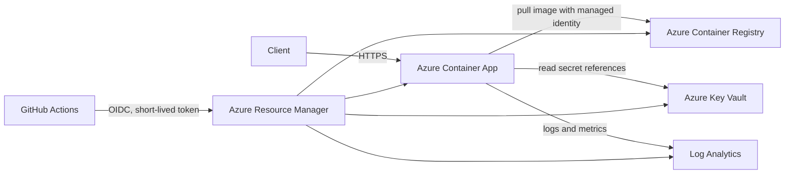

# Target architecture

## Runtime flow

Development and production use the same Terraform module but separate resource groups, state keys, identities, configuration and GitHub environments. This limits blast radius and makes promotion explicit.

## Why Container Apps instead of AKS

The workload is described as one containerized API and the team is small. Container Apps retains the container and autoscaling model while Azure operates the control plane, ingress and most platform plumbing. AKS would be justified once Kubernetes-specific APIs, custom controllers, complex service networking, or a larger multi-service platform become real requirements.

## Security boundaries

- GitHub authenticates with federated OIDC subjects scoped to repository, branch/pull request and GitHub environment.
- Runtime uses a user-assigned managed identity.
- `AcrPull` and `Key Vault Secrets User` are granted to runtime; no registry password is exposed.
- Terraform receives secret identifiers, not secret values.
- Production uses a dedicated GitHub environment with required reviewers.
- State storage disables public blob access, uses Azure RBAC, blob versioning,
  seven-day soft delete, and a `CanNotDelete` account lock.
- Deployment identities may delegate only `AcrPull` and `Key Vault Secrets User`;
  the RBAC administrator assignment is constrained with an Azure ABAC condition.

## State and environments

Bootstrap creates one private state container per environment plus a private,
seven-day `tfplans` container. A dedicated pull-request identity can only read
state. The main-branch plan identity can read state and write saved plans, but
cannot change state. Each deployer writes only its own environment state.
The shared platform root receives a distinct backend container and key at init time for each environment:

- `tfstate-dev/api-platform/dev.tfstate`
- `tfstate-prod/api-platform/prod.tfstate`

PR plans use `-lock=false` because their identity is read-only. Production plans
are uploaded directly to Azure Storage instead of becoming GitHub artifacts;
after environment approval, the production identity downloads and applies that
exact saved plan.

The `CanNotDelete` lock applies to ARM control-plane operations at the storage
account scope. With AzureRM 4.x containers use `storage_account_id`, so deleting
a container through ARM is blocked; inherited account-scope role assignments can
also fail deletion with `ScopeLocked`. Bootstrap migration therefore needs two
passes: remove the legacy container and account-scope assignments first, then
create the lock. Removing an environment or destroying bootstrap later requires
removing the lock first. Data-plane blob writes remain governed by data-plane
RBAC, versioning, soft delete, and lifecycle policy.

## Reliability and cost

- Dev may scale to zero; production keeps one minimum replica.
- Log retention is shorter in dev than prod.
- ACR Basic and consumption-based Container Apps avoid fixed cluster cost.
- Revision-based rollout supports quick rollback.
- For a larger platform, add Front Door/WAF, private endpoints, zone-aware capacity, alert rules and a tested disaster-recovery plan.

