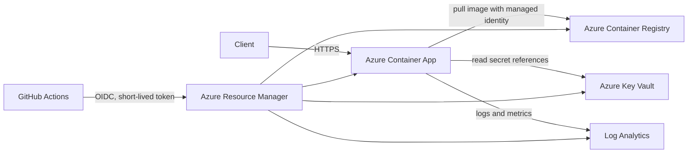

# Target architecture

## Runtime flow

Development and production use the same Terraform module but separate resource groups, state keys, identities, configuration and GitHub environments. This limits blast radius and makes promotion explicit.

## Why Container Apps instead of AKS

The workload is described as one containerized API and the team is small. Container Apps retains the container and autoscaling model while Azure operates the control plane, ingress and most platform plumbing. AKS would be justified once Kubernetes-specific APIs, custom controllers, complex service networking, or a larger multi-service platform become real requirements.

## Security boundaries

- GitHub authenticates with federated OIDC subjects scoped to repository, branch/pull request and GitHub environment.
- Runtime uses a user-assigned managed identity.
- `AcrPull` and `Key Vault Secrets User` are granted to runtime; no registry password is exposed.
- Terraform receives secret identifiers, not secret values.
- Production uses a dedicated GitHub environment with required reviewers.
- State storage disables public blob access and uses Azure RBAC.

## State and environments

Bootstrap creates a private state storage account/container plus environment resource groups and deployment identities. Each root module uses a distinct key:

- `job-radar/dev.tfstate`
- `job-radar/prod.tfstate`

State locking is handled by the AzureRM backend. Production and development never share a root state.

## Reliability and cost

- Dev may scale to zero; production keeps one minimum replica.
- Log retention is shorter in dev than prod.
- ACR Basic and consumption-based Container Apps avoid fixed cluster cost.
- Revision-based rollout supports quick rollback.
- For a larger platform, add Front Door/WAF, private endpoints, zone-aware capacity, alert rules and a tested disaster-recovery plan.

